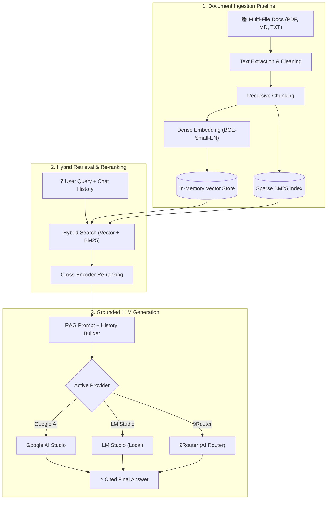

# ⚡ RAG Nexus — Advanced Modular RAG Engine

[](https://github.com/AmirGhz-2030)
[](https://fastapi.tiangolo.com/)
[](https://www.python.org/)
[](LICENSE)
[](README.md)
[](README.fa.md)

> 🌐 **Read this in other languages:** **English** | [فارسی (Persian)](README.fa.md)

**RAG Nexus** is a modular, production-ready **Retrieval-Augmented Generation (RAG)** engine designed for intelligent document exploration, hybrid search, multi-file analysis, and grounded natural-language question answering.

Developed by **[AmirGhz-2030](https://github.com/AmirGhz-2030)**, it combines **Hybrid Search (Dense + BM25)**, **Cross-Encoder Re-ranking**, **Multi-LLM Provider Switching** (local & cloud), and a modern **Dark Glassmorphism Web Dashboard**.

---

## 🌟 Key Features

### 🔍 1. Hybrid Search Engine
- **Dense Vector Search:** Uses `BAAI/bge-small-en-v1.5` for semantic similarity retrieval.
- **Sparse Keyword Search:** Uses `BM25Okapi` for exact lexical matching.
- **Adaptive Hybrid Weighting (Alpha Slider):** Configurable weighting between dense vector and BM25 scores with automatic parameter presets per file type (`PDF`, `Markdown`, `TXT`).

### 🎯 2. Cross-Encoder Re-ranking
- Uses `cross-encoder/ms-marco-MiniLM-L-6-v2` to accurately score and re-rank retrieved chunks against the user's query.

### 🤖 3. Multi-LLM Provider Support
Switch seamlessly between three LLM backends directly from the UI without restarting the server:
1. 🔵 **Google AI Studio:** Gemini model family (`gemini-2.5-flash`, `gemini-2.5-pro`).
2. 💻 **LM Studio (Local):** Local OpenAI-compatible inference server (`http://localhost:1234/v1`).
3. ⚡ **9Router:** Smart AI model router (`http://localhost:20128/v1`).

### ⚙️ 4. Live API Settings & Connection Testing
- Built-in API settings panel with masked API keys for security.
- One-click **🔌 Test Connection** check reporting live response latency and diagnostics.

### 📚 5. Multi-File Ingestion & Index Management
- Drag-and-drop multi-file upload (`PDF`, `Markdown`, `TXT`).
- Sidebar list of indexed documents with per-file chunk counts.
- **🗑️ Clear Index** button to wipe memory and load fresh document sets.

### 💬 6. Chat History, Persistence & Export
- **Multi-turn Context Memory:** Sends recent conversation turns alongside retrieved context.
- **Browser Persistence:** Automatically saves chat history to `localStorage`.
- **💾 Export Chat:** Downloads the entire conversation as a Markdown (`.md`) file.
- **🗑️ Clear Chat:** Resets the conversation window cleanly.

---

## 🏗️ System Architecture



---

## 🛠️ Tech Stack

### Backend
- **Python:** Python 3.11+
- **Web Framework:** [FastAPI](https://fastapi.tiangolo.com/) + [Uvicorn](https://www.uvicorn.org/)
- **Embeddings:** `SentenceTransformers` (`BAAI/bge-small-en-v1.5`)
- **Re-ranking:** `CrossEncoder` (`cross-encoder/ms-marco-MiniLM-L-6-v2`)
- **Sparse Retrieval:** `rank-bm25` (`BM25Okapi`)
- **PDF Extraction:** `pypdf`
- **Configuration:** `pydantic-settings`
- **HTTP Client:** `requests`

### Frontend
- **HTML5 & CSS3:** Vanilla CSS with dark Glassmorphism styling and Google Outfit typography.
- **JavaScript:** Modern ES6+, Fetch API, and `localStorage`.

---

## 🚀 Quick Start

### 1. Clone the Repository
```bash
git clone https://github.com/AmirGhz-2030/rag-nexus.git
cd rag-nexus
```

### 2. Install Dependencies
Navigate into the `backend` directory and install required packages:
```bash
cd backend
pip install -r requirements.txt
```

### 3. Configure Environment Variables (`.env`)
Copy `env.example` to `.env` in the project root:
```bash
cp ../env.example ../.env
```
Edit `.env` according to your preferred provider (or configure it live from the web dashboard):
```env
LLM_PROVIDER=google
GOOGLE_API_KEY=your_google_api_key_here
GOOGLE_MODEL=gemini-2.5-flash

LMSTUDIO_BASE_URL=http://localhost:1234/v1
LMSTUDIO_MODEL=default

NINEROUTER_BASE_URL=http://localhost:20128/v1
NINEROUTER_API_KEY=your_9router_key
NINEROUTER_MODEL=hermes_test
```

### 4. Run the Application
Start the FastAPI server:
```bash
python app/main.py
```

Once running, open the dashboard in your browser:
👉 **[http://localhost:8000](http://localhost:8000)**

---

## 📖 User Guide

1. **Configure LLM Provider:**
   - Open the **⚙️ API Settings** section in the sidebar and choose your provider (Google AI Studio / LM Studio / 9Router).
   - Enter your API key or server URL and model name, then click **💾 Save**.
   - Click **🔌 Test** to verify connectivity and inspect latency.

2. **Ingest Documents:**
   - Drag and drop one or more `PDF`, `Markdown`, or `TXT` files into **Document Ingestion**.
   - Retrieval parameters (`Top-K` and `Alpha`) auto-adjust based on document type.
   - Uploaded documents and chunk counts appear in the sidebar.

3. **Query & Chat:**
   - Ask questions about your documents in the chat bar.
   - Re-ranked context chunks and scores appear in the right inspector panel alongside the generated answer.

4. **Manage History & Index:**
   - Click **🗑️ Clear Index** to reset indexed documents.
   - Click **💾 Export Chat** to save your conversation as Markdown.
   - Click **🗑️ Clear Chat** to clear the chat thread.

---

## 📡 REST API Reference

| Method | Endpoint | Description |
| :--- | :--- | :--- |
| `GET` | `/api/v1/health` | Check server status, indexed chunk count, and active LLM provider |
| `GET` | `/api/v1/documents` | List indexed documents and per-file chunk counts |
| `POST` | `/api/v1/ingest` | Upload and index one or multiple documents (`PDF`, `TXT`, `MD`) |
| `POST` | `/api/v1/clear-index` | Clear all indexed documents from memory |
| `POST` | `/api/v1/query` | Execute hybrid search, cross-encoder re-ranking, and LLM generation |
| `GET` | `/api/v1/settings` | Retrieve current LLM settings (with masked API keys) |
| `POST` | `/api/v1/settings` | Update provider settings live and persist them to `.env` |
| `POST` | `/api/v1/test-connection` | Test live connectivity to the active LLM provider |

---

## 👨‍💻 Developer

Designed and implemented by **[AmirGhz-2030](https://github.com/AmirGhz-2030)**.

- **GitHub:** [https://github.com/AmirGhz-2030](https://github.com/AmirGhz-2030)
- **Project:** RAG Nexus Engine

---

## 📜 License

This project is licensed under the **MIT License** — see the [LICENSE](LICENSE) file for details.
