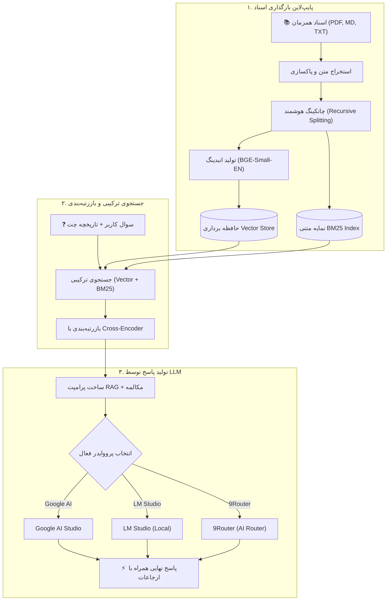

# ⚡ RAG Nexus — موتور پیشرفته و ماژولار RAG (Advanced Modular RAG Engine)

[](https://github.com/AmirGhz-2030)
[](https://fastapi.tiangolo.com/)
[](https://www.python.org/)
[](LICENSE)

**RAG Nexus** یک سیستم کاملاً پیشرفته، قدرتمند و ماژولار مبتنی بر معماری **RAG (Retrieval-Augmented Generation)** است که برای کاوش هوشمند، جستجوی دقیق ترکیبی، تحلیل اسناد و پاسخ‌دهی به زبان طبیعی توسعه یافته است.

این پروژه توسط **[AmirGhz-2030](https://github.com/AmirGhz-2030)** پیاده‌سازی شده و از آخرین تکنولوژی‌های هوش مصنوعی شامل **جستجوی ترکیبی (Hybrid Search)**، **بازرتبه‌بندی با Cross-Encoder**، **پشتیبانی از پرووایدرهای محلی و ابری** و یک **داشبورد تعاملی تاریک با استایل Glassmorphism** بهره می‌برد.

---

## 🌟 قابلیت‌های اصلی سیستم (Key Features)

### 🔍 ۱. جستجوی ترکیبی پیشرفته (Hybrid Search Engine)
- **Dense Vector Search**: استفاده از مدل برداری قدرتمند `BAAI/bge-small-en-v1.5` برای درک سمانتیک و مفهومی متن.
- **Sparse Keyword Search**: استفاده از الگوریتم `BM25Okapi` برای تطبیق کلمات کلیدی و دقیق.
- **تنظیم وزن هوشمند (Alpha Slider)**: وزن‌دهی قابل تنظیم بین جستجوی برداری و کلمات کلیدی با تشخیص خودکار نوع فایل (`PDF`, `Markdown`, `TXT`).

### 🎯 ۲. بازرتبه‌بندی نتایج (Cross-Encoder Re-ranking)
- استفاده از مدل تخصصی `cross-encoder/ms-marco-MiniLM-L-6-v2` برای ارزیابی دقیق ارتباط پرامپت و چانک‌های بازیابی‌شده.

### 🤖 ۳. پشتیبانی از پرووایدرهای مختلف (Multi-LLM Provider Support)
امکان انتخاب و سوئیچ زنده بین ۳ پرووایدر بدون نیاز به ریستارت سرور:
1. 🔵 **Google AI Studio**: پشتیبانی از مدل‌های خانواده Gemini (`gemini-2.5-flash`, `gemini-2.5-pro`).
2. 💻 **LM Studio (Local)**: اتصال به مدل‌های هوش مصنوعی اجراشده روی سیستم لوکال (`http://localhost:1234/v1`).
3. ⚡ **9Router**: روتر هوشمند AI برای مدیریت و سوئیچ بین مدل‌ها (`http://localhost:20128/v1`).

### ⚙️ ۴. تست زنده اتصال و تنظیمات API (Live API Settings & Test Connection)
- پنل تنظیمات API در داشبورد با نمایش کلیدهای ماسک‌شده برای امنیت بالا.
- دکمه **🔌 Test Connection** جهت تست زنده اتصال با نمایش تاخیر (Latency) و خطایابی خودکار.

### 📚 ۵. مدیریت چند فایلی اسناد (Multi-File Ingestion & Index Management)
- قابلیت بارگذاری همزمان چند فایل (`PDF`, `Markdown`, `TXT`).
- نمایش لیست اسناد ایندکس‌شده در سایدبار به همراه تعداد چانک‌های هر فایل.
- دکمه **🗑️ Clear Index** جهت پاک‌سازی کامل حافظه اسناد قبلی و بارگذاری فایل‌های جدید.

### 💬 ۶. حافظه چت، ذخیره‌سازی، خروجی و پاک‌سازی (Chat History & Memory)
- **حافظه چندمرحله‌ای مکالمه (Multi-turn Context)**: ارسال تاریخچه چت‌های قبلی برای مدل جهت حفظ روند مکالمه.
- **ذخیره خودکار چت**: حفظ پیام‌ها در `localStorage` مرورگر.
- **دکمه 💾 Export Chat**: دریافت خروجی کامل گفتگوها با فرمت Markdown (`.md`).
- **دکمه 🗑️ Clear Chat**: پاک کردن کامل تاریخچه چت.

---

## 🏗️ معماری سیستم (System Architecture)



---

## 🛠️ تکنولوژی‌های استفاده‌شده (Tech Stack)

### بک‌اند (Backend)
- **پایتون**: Python 3.11+
- **فریم‌ورک وب**: [FastAPI](https://fastapi.tiangolo.com/) + [Uvicorn](https://www.uvicorn.org/)
- **پردازش متن و انبدینگ**: `SentenceTransformers` (`BAAI/bge-small-en-v1.5`)
- **بازرتبه‌بندی**: `CrossEncoder` (`cross-encoder/ms-marco-MiniLM-L-6-v2`)
- **جستجوی متنی**: `rank-bm25` (BM25Okapi)
- **پردازش اسناد**: `pypdf`
- **تنظیمات و متغیرها**: `pydantic-settings`
- **ارتباطات HTTP**: `requests`

### فرانت‌اند (Frontend)
- **HTML5 & CSS3**: Vanilla CSS با تم تاریک مدرن، افکت Glassmorphism و فونت Google Outfit.
- **جاوااسکریپت**: JavaScript ES6+ مدرن، Fetch API، LocalStorage.

---

## 🚀 راهنمای سریع نصب و اجرا (Quick Start)

### ۱. کلون کردن مخزن
```bash
git clone https://github.com/AmirGhz-2030/rag-nexus.git
cd rag-nexus
```

### ۲. نصب پیش‌نیازها
وارد پوشه `backend` شده و پکیج‌ها را نصب کنید:
```bash
cd backend
pip install -r requirements.txt
```

### ۳. تنظیم متغیرهای محیطی (`.env`)
فایل `env.example` را به `.env` کپی کنید:
```bash
cp ../env.example ../.env
```
محتوای فایل `.env` را بر اساس نیاز خود تنظیم کنید (همچنین می‌توانید تنظیمات را مستقیماً در داشبورد وب انجام دهید):
```env
LLM_PROVIDER=google
GOOGLE_API_KEY=your_google_api_key_here
GOOGLE_MODEL=gemini-2.5-flash

LMSTUDIO_BASE_URL=http://localhost:1234/v1
LMSTUDIO_MODEL=default

NINEROUTER_BASE_URL=http://localhost:20128/v1
NINEROUTER_API_KEY=your_9router_key
NINEROUTER_MODEL=hermes_test
```

### ۴. اجرای برنامه
سرور FastAPI را اجرا کنید:
```bash
python app/main.py
```

پس از اجرای موفق، داشبورد برنامه روی آدرس زیر در دسترس خواهد بود:
👉 **[http://localhost:8000](http://localhost:8000)**

---

## 📖 راهنمای استفاده از برنامه (User Guide)

1. **تنظیم پرووایدر هوش مصنوعی**:
   - در پنل **⚙️ API Settings** سایدبار، پرووایدر خود (Google AI Studio / LM Studio / 9Router) را انتخاب کنید.
   - API Key یا آدرس و نام مدل را وارد کرده و **💾 Save** را بزنید.
   - روی دکمه **🔌 Test** کلیک کنید تا صحت اتصال با پیام سبز تایید شود.

2. **بارگذاری اسناد (Document Ingestion)**:
   - فایل‌های PDF، Markdown یا TXT خود را بکشید و در کادر **Document Ingestion** رها کنید (امکان انتخاب همزمان چند فایل وجود دارد).
   - سیستم پارامترهای Top-K و Alpha را به‌صورت اتوماتیک تنظیم می‌کند.
   - لیست اسناد بارگذاری‌شده در سایدبار نمایش داده می‌شود.

3. **چت و پرسش از اسناد**:
   - سوال خود را در کادر چت بنویسید.
   - نتایج بازیابی‌شده به همراه امتیاز Rerank در پنل سمت راست نمایش داده می‌شوند و پاسخ تولیدشده توسط LLM در چت ارائه می‌شود.

4. **مدیریت تاریخچه و اسناد**:
   - جهت پاک‌سازی اسناد قبلی از دکمه **🗑️ Clear Index** استفاده کنید.
   - جهت دانلود خروجی چت با فرمت Markdown از **💾 Export Chat** استفاده کنید.
   - جهت پاک کردن چت از دکمه **🗑️ Clear Chat** استفاده کنید.

---

## 📡 مستندات API (REST API Reference)

| روش (Method) | مسیر (Endpoint) | توضیحات |
| :--- | :--- | :--- |
| `GET` | `/api/v1/health` | بررسی وضعیت سرور، تعداد چانک‌ها و سرویس LLM فعال |
| `GET` | `/api/v1/documents` | دریافت لیست اسناد ایندکس‌شده به همراه تعداد چانک‌ها |
| `POST` | `/api/v1/ingest` | آپلود و ایندکس یک یا چند سند همزمان (PDF, TXT, MD) |
| `POST` | `/api/v1/clear-index` | پاک‌سازی کامل اسناد ایندکس‌شده از حافظه |
| `POST` | `/api/v1/query` | اجرای جستجوی ترکیبی، Reranking و تولید پاسخ با تاریخچه |
| `GET` | `/api/v1/settings` | دریافت تنظیمات فعلی (کلیدها به‌صورت ماسک‌شده) |
| `POST` | `/api/v1/settings` | ذخیره و آپدیت زنده تنظیمات پرووایدر در فایل `.env` |
| `POST` | `/api/v1/test-connection` | تست زنده اتصال به پرووایدر هوش مصنوعی انتخابی |

---

## 👨‍💻 توسعه‌دهنده (Developer)

این پروژه توسط **[AmirGhz-2030](https://github.com/AmirGhz-2030)** طراحی و پیاده‌سازی شده است.

- **گیت‌هاب**: [https://github.com/AmirGhz-2030](https://github.com/AmirGhz-2030)
- **پروژه**: RAG Nexus Engine

---

## 📜 مجوز (License)

این پروژه تحت مجوز **MIT** منتشر شده است. استفاده، تغییر و توسعه آن آزاد است.
